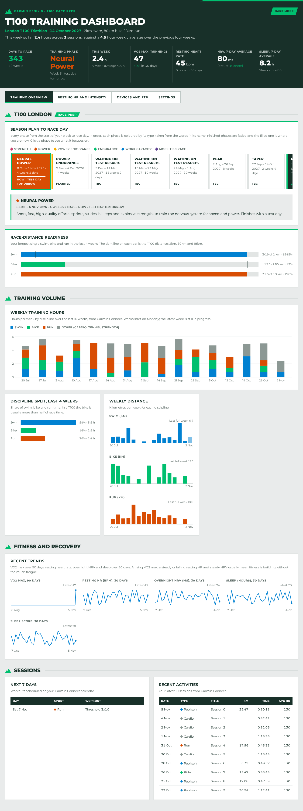

# T100 Training Dashboard

A personal training dashboard for T100 triathlon preparation. It pulls your data live from **Garmin Connect** (built and tested with a Fenix 8) and combines it with your own season plan, race countdown, FTP tests and training-device readings.

It runs as a small server on your own computer. Open it in a browser, or install it as an app from the browser.



## What it shows

- **Training overview**
  - Days to race, the current training phase and days to its test day.
  - This week's hours.
  - VO2 max, resting HR, HRV and sleep.
  - A clickable season plan: colour-coded phase squares, each with a focus description.
  - Race-distance readiness: your longest swim, bike and run against 2 km / 80 km / 18 km.
  - Weekly hours by sport, discipline split and weekly distance.
  - 90- and 30-day fitness trends.
  - Scheduled workouts and your 10 latest activities.
- **Resting HR and intensity**
  - 30-day resting heart rate.
  - Garmin's load focus (aerobic low, aerobic high and anaerobic, against your target ranges).
  - Acute and chronic load.
  - Aerobic and anaerobic training effect for each session.
- **Devices and FTP**
  - FTP history with W/kg, plus Garmin's own FTP estimate.
  - A log of readings from in-training devices: weight sensors, bike sensors, Wahoo.
  - The devices on your Garmin account.
- **Settings**
  - Edit your race and season phases.
  - Log FTP tests and device readings.
  - Refresh from Garmin.

Phase colours are set automatically from words in a phase's name:

| Word in name | Colour |
|---|---|
| strength | raspberry |
| power | orange |
| power endurance | gold |
| endurance | green |
| capacity | blue |
| mock / T100 race | plum |

There's a light and a dark mode; it starts in the one your computer uses.

## Before you start: how the Garmin connection works

Garmin doesn't offer a public API for personal data. This app uses the open-source [`garminconnect`](https://github.com/cyberjunky/python-garminconnect) library, which signs in to Garmin Connect the way the Garmin website does.

- You sign in **once**, on your own computer. The app then stores Garmin's login **tokens** (not your password) in `.garminconnect/`.
- Treat that folder like a password. It's in `.gitignore`, so never commit it or share it.
- This approach is unofficial and can break if Garmin changes its sign-in. If it does, update the library with `pip install -U garminconnect`.
- Use it with your own account only.

## Quick start (Windows, macOS or Linux)

You need **Python 3.10 or newer**.

```bash
git clone https://github.com/<you>/t100-dashboard.git
cd t100-dashboard
python -m venv .venv
# Windows:  .venv\Scripts\activate
# macOS/Linux:
source .venv/bin/activate
pip install -r requirements.txt

python server/app.py --login   # one time: your Garmin email, password and MFA code if you use one
python server/app.py           # start the dashboard
```

Then open **http://127.0.0.1:8100**.

### Install it as an app

- **Chrome or Edge:** open the dashboard, then choose **Install T100 Training Dashboard** from the address bar or the ⋮ menu. It gets its own window and a desktop or Start-menu icon.
- **Safari on iPhone or iPad:** use Share → **Add to Home Screen**. This works only when the server can be reached from the phone; see "Use it from other devices".

The server needs to be running for new data to load. To start it automatically:

- **Windows:** add `python server\app.py` to Task Scheduler at log-on.
- **macOS or Linux:** use a launchd job or a systemd service.

## First steps in the app

1. **Settings → Your race:** enter your race name, date and distances.
2. **Settings → Season phases:** add one row per phase with name, start date, end date, focus and an optional status such as "TBC". The repo ships with an example plan; replace it with yours.
3. **Settings → Log an FTP test / Log a device reading:** add results as you get them.

Your own data is saved in `data/*.json` and isn't committed to git.

## Use it from other devices (optional)

By default the server only listens on your own computer. To open it from your phone on the same network:

```bash
T100_APP_TOKEN="a-long-random-string" python server/app.py --host 0.0.0.0
```

Then on the phone:

1. Go to `http://<your-computer's-IP>:8100`.
2. Open **Settings** and paste the same string into **App token**.

The server refuses to listen beyond your computer without a token. If you put it on the internet, run it behind HTTPS, for example with Caddy, Cloudflare Tunnel or Tailscale.

## Docker

```bash
docker compose build
docker compose run --rm t100 python server/app.py --login   # one time
docker compose up -d
```

Edit `T100_APP_TOKEN` in `docker-compose.yml` first, then enter the same token in the app's **Settings** tab. Your tokens and data are saved in `./data`.

## Configuration

| Variable | Default | What it does |
|---|---|---|
| `T100_HOST` / `T100_PORT` | `127.0.0.1` / `8100` | Where the server listens |
| `T100_APP_TOKEN` | *(none)* | Token required on every data request; needed when listening beyond localhost |
| `T100_DATA_DIR` | `./data` | Where your race, phases, FTP tests and device log are saved |
| `GARMINTOKENS` | `./.garminconnect` | Where Garmin login tokens are saved |
| `T100_CACHE_SECONDS` | `900` | How long Garmin answers are cached |
| `GARMIN_EMAIL` / `GARMIN_PASSWORD` | *(none)* | Optional; used to sign in again if the tokens expire |

## Project layout

```
server/app.py        Flask server: Garmin sign-in, data endpoints, your saved data, serves the app
web/index.html       The dashboard (markup, styles and drawing code)
web/dash-shim.js     Loads each table from the server and redraws the page when data changes
web/settings.js      The Settings tab
web/sw.js, web/manifest.webmanifest, web/icons/   Installable-app files
web/fonts/           Montserrat (SIL Open Font License)
web/d3.min.js        d3 v7 (ISC licence)
data/*.example.json  Example race and season plan
```

## Troubleshooting

- **"Not signed in to Garmin"**: run `python server/app.py --login` again.
- **A card says "Failed to load"**: open the browser console to see the error, or check the server window. Garmin sometimes rate-limits; wait a few minutes and use **Settings → Refresh from Garmin**.
- **Numbers look out of date**: sync your watch with the Garmin Connect app, then refresh. Answers are cached for 15 minutes.

## Licence

MIT for this project's code. Montserrat is under the SIL Open Font License, d3 under ISC, and `garminconnect` under MIT. This project isn't affiliated with or endorsed by Garmin.
